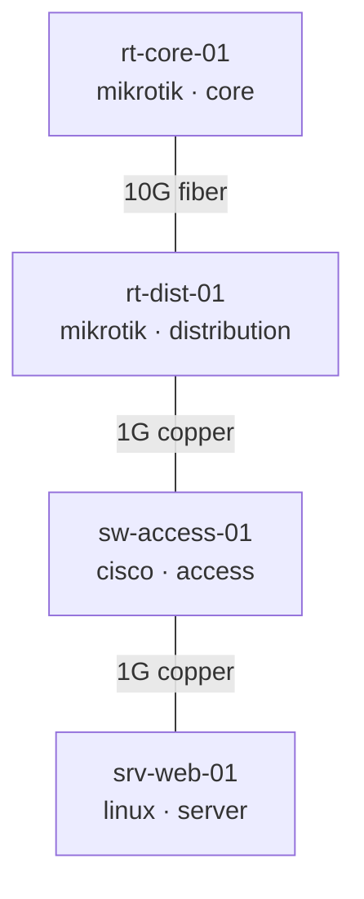

# Topologia da Rede

> Arquivo **gerado** por `scripts/docs/topology_render.py`. Não edite à mão.

## Segmentos lógicos

| Segmento | VLAN | Sub-rede |
|----------|------|----------|
| Gerência | 99 | 10.0.0.0/24 |
| Acesso | 10 | 10.0.10.0/24 |
| Servidores | 20 | 10.0.20.0/24 |

_Gerado em: 2026-05-18 21:02 UTC — 4 host(s), 3 enlace(s)._
